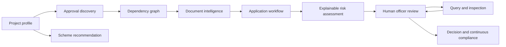
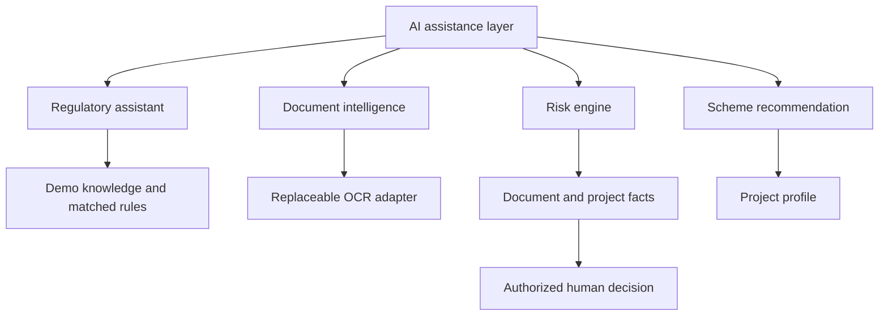
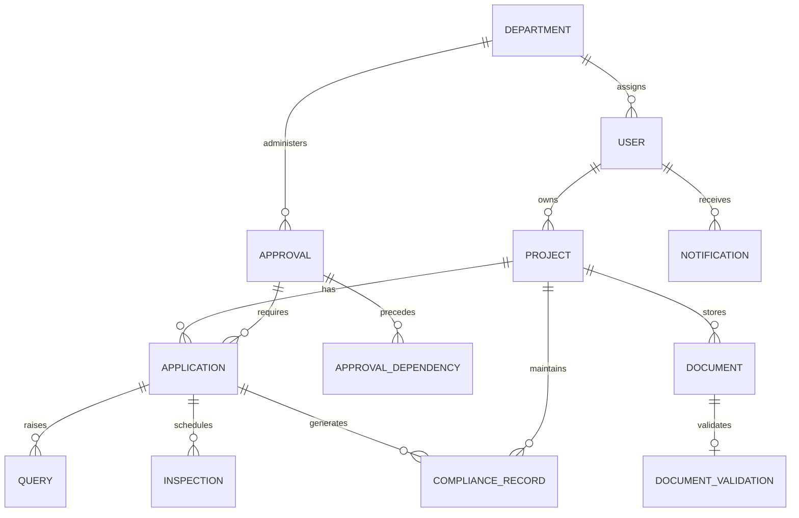

# NIRMAN architecture

The prototype implements a modular monolith: a Next.js frontend, a FastAPI REST service, and a relational database. Docker uses PostgreSQL; local development can use SQLite. External regulatory systems are represented by demonstration adapters.

**AI recommends. Rules validate. Officers decide.**

## Service boundaries

| Service | Responsibility | Future extension point |
| --- | --- | --- |
| approvalService | Enabled rules match industry, state, investment, hazardous materials; graph timing is calculated from prerequisites | Verified regulatory catalogue and official department adapters |
| documentService | Store files, invoke OCRAdapter, compare fields with project profile, persist validation | OCR provider and validated extraction schema |
| riskService | Explainable point contributions and advisory recommendation | Additional verified risk signals |
| complianceService | Demo score; renewal obligations created after human approval | Verified license conditions and renewal policies |
| schemeService | Match illustrative schemes to profile | Verified government scheme catalogue |
| aiService | Source/rule/explanation answers; optional LLM rephrasing with deterministic fallback | Grounded regulatory retrieval |

The UI communicates with typed frontend service wrappers through `/api`. Next.js proxies those requests to FastAPI. Files use multipart upload; project and workflow mutations use JSON. Database writes, application history, audit events and notifications are committed together.

## AI layer

The mock OCR adapter intentionally does not read uploaded content. It returns project-aligned fixture values and a 100-employee value for Project Report. The validation engine detects the discrepancy when the project has 120 employees. Provider labels explain this throughout the interface.

Risk contributions: missing category +25, cross-document warning +20, expired document +15, hazardous industry +20, previous compliance issue +15, complete documentation −15. The latest file in each category is assessed. Scores clamp to 0–100; low is below 35, medium is 35–64, high is 65+. Scores are advisory and cannot change an application’s status.

The seeded dependency path totals 42 days: Factory Registration (1) → Pollution Consent (30) → Environmental Approval (4) → Final Operation Clearance (7). Four branches follow registration in parallel. These durations are demo estimates, not statutory service guarantees. Disabled rules are excluded from discovery and graph timing.

## Relational model

ApprovalRule contains enabled conditions and approval IDs. Scheme contains illustrative eligibility criteria and benefits. AuditLog records timestamp, user name, role, action, entity and result. Roles are explicit entrepreneur/officer/admin values; authorization is checked by the backend, independent of UI navigation.

## Workflow invariants

- Applicants can access their own projects and applications; officers and admins can inspect demo dossiers.
- Only applicants create projects, upload applicant documents and submit applications.
- Only officers raise queries, schedule inspections, and record decisions.
- Query responses must attach a document belonging to the same project.
- Completed inspections require a report.
- Approval is blocked while any query awaits an applicant response or any inspection remains incomplete.
- Final decisions cannot be replaced or queried again.
- Approval creates a renewal obligation and sends a notification.
- Administrator rule toggles affect future discovery; existing application history is retained.
- No legal certificate is issued and no government API is invoked.

## Prototype tradeoffs

Opaque auth tokens live in a single backend process and disappear on restart. Registration and demo login have no password. Schema creation and seeding happen at startup; migration infrastructure is intentionally deferred. The ordinary application tables contain active demo transactions, while seeded project progress includes a demonstration baseline for the judging dashboard. Historical chart values, scores and benefits are illustrative.

PostgreSQL is configured in Compose, but the restricted implementation environment only allowed execution against SQLite and the in-process ASGI interface. There is no deployment or external integration in this repository.
